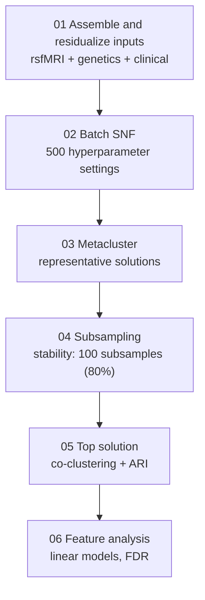

# snf-subtyping

Multimodal subtyping with similarity network fusion (SNF) and meta clustering.

Original project aimed to parse autism heterogeneity across scales by integrating resting-state fMRI connectivity, polygenic scores, and clinical measures. This pipeline is customizable to take in any dataframes as inputs, perform SNF, model selection, compare cluster demographics, and perform feature attribution. 

## Overview

The pipeline uses [`metasnf`](https://branchlab.github.io/metasnf/) (Velayudhan, P. S. et al.) to:

1. Build a data list of three modalities (rsfMRI network connectivity, genetics, clinical).
2. Generate hundreds of SNF cluster solutions across a grid of hyperparameters.
3. Group similar solutions into metaclusters and pick one representative solution per metacluster.
4. Test the stability of each representative solution by resampling.
5. Select a top solution and compare clusters (and a typically developing comparison group) on every input feature, with FDR correction.



## Repository layout

```
scripts/
  01_input.R              load and align residualized modality datasheets, build data_list
  02_metasnf.R            generate SNF config and run batch SNF
  03_repsol.R             metacluster and identify representative solutions
  04_subsample.R          subsampling model selection: solution (ARI) and subject (co-clustering) stability
  05_toprep.R             select the top solution
  06_analysis_features.R  demographics and per-feature linear models across clusters/groups
data-raw/
  simulate_data.R         generates synthetic data with the expected structure
```

## Quick start with simulated data

```bash
Rscript data-raw/simulate_data.R     # creates ./simulated_project/
```

Then, for each script in `scripts/`, fill in the placeholders (marked `xxx` or left blank on purpose) and run the scripts in numeric order:

| Placeholder | Where | What to enter |
|---|---|---|
| Working directory | every script (comment line) | the folder the comment names; `<project root>` is `simulated_project/` or your own data folder |
| `run` | 01-06 | name of the analysis run, e.g. `"snf9"` (the simulator creates `snf/snf9/`) |
| `split_vec` | 03 | row indices that split the solutions into metaclusters, read from the `shiny_annotator()` heatmap |
| `top_row_number`, `top_metacluster_letter`, `top_solution_number` | 05 and 06 | the top solution printed by 05 |

## Manual steps

Two steps need a human decision:

- **`03_repsol.R`:** inspect the interactive heatmap with `shiny_annotator()` and set `split_vec` to metacluster.
- **`05_toprep.R` and `06_analysis_features.R`:** after `05_toprep.R` prints the top solution, enter its row, metacluster letter, and solution number in the marked block (it appears in both scripts).

## Using your own data

Expected layout under `<project root>`:

```
snf_inputs/   input_rsfmri_networks.csv, input_genetics.csv, input_clinical.csv
              (ASD participants only, no missing values, ID column ACE_ID)
              SNF_MASTER_ALL.csv (all participants: IDs, Group, FSIQ, Age_Years, Sex,
              Site_Scanner, and every feature)
static/       SNF_demos.csv (demographics)
snf/<run>/    created outputs: R_vars/, figures/, analysis_outputs/
```

See `data-raw/simulate_data.R` for exact column names. Participant IDs to exclude can be set in the `excluded_ids` line of `06_analysis_features.R`.

## Status

Scripts 01-06 are included. 

## References and acknowledgements

- Wang, B. et al. (2014). Similarity network fusion for aggregating data types on a genomic scale. *Nature Methods*. doi:10.1038/nmeth.2810
- Caruana, R. et al. (2006). Meta clustering. *IEEE ICDM*.
- Velayudhan, P. S. et al. `metasnf`: Meta Clustering with Similarity Network Fusion (R package, GPL-3). 

The pipeline structure follows the `metasnf` documentation and vignettes; the generated figures, stability summaries and downstream statistics were developed for this project.
